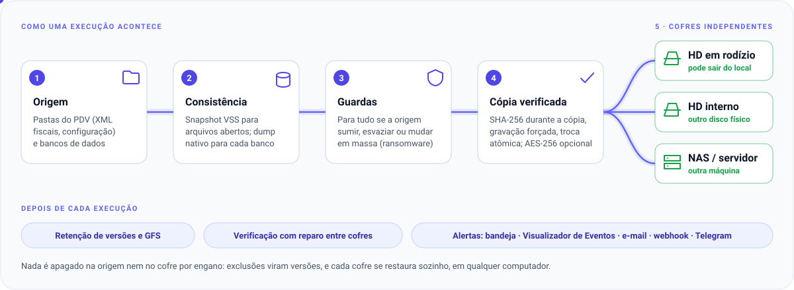
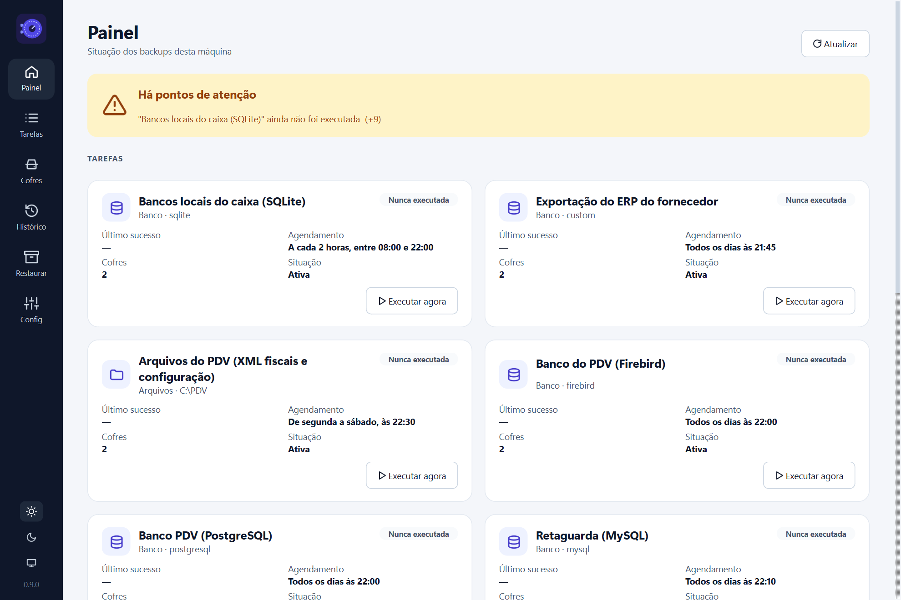
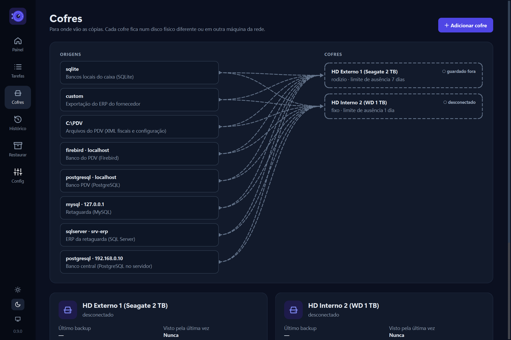
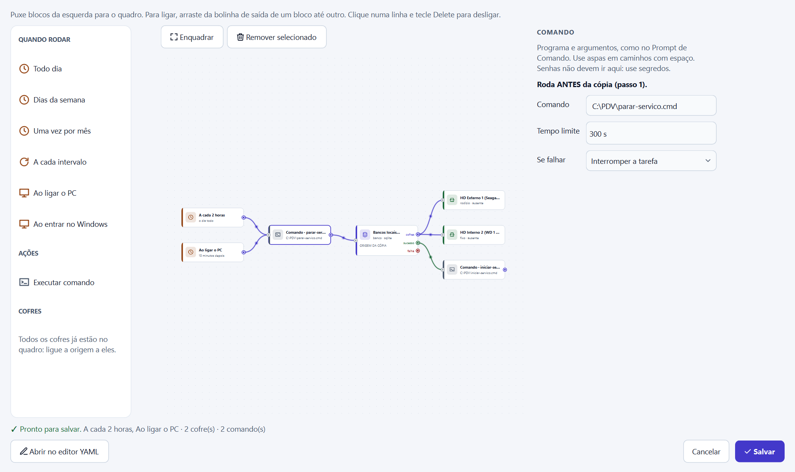
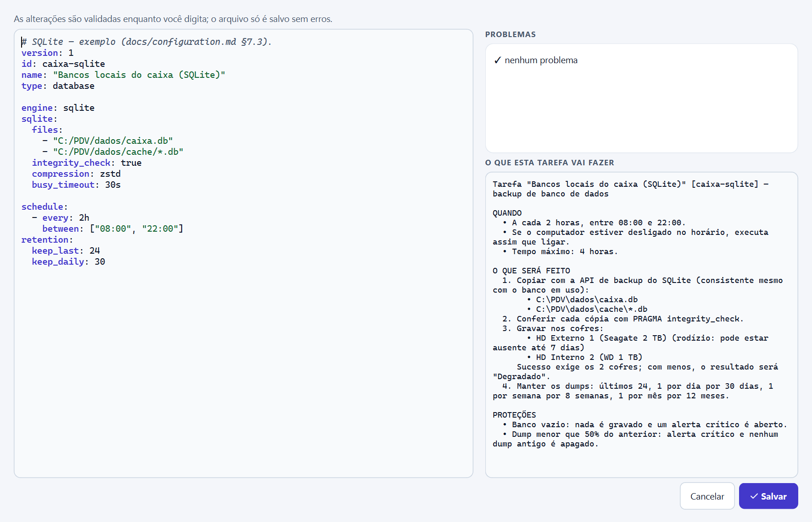
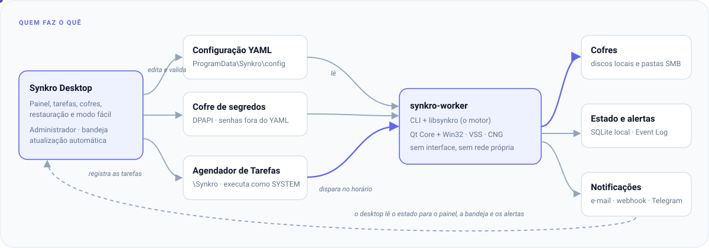

<p align="center">
  
</p>

<p align="center">
  <a href="https://github.com/BirdRa1n/Synkro/releases"></a>
  <a href="https://github.com/BirdRa1n/Synkro/actions/workflows/ci.yml"></a>
  
  
  <a href="LICENSE"></a>
</p>

<p align="center">
  <a href="#-instalação">Instalação</a> ·
  <a href="#-primeiros-passos">Primeiros passos</a> ·
  <a href="#-recursos">Recursos</a> ·
  <a href="#-configuração">Configuração</a> ·
  <a href="#-linha-de-comando">Linha de comando</a> ·
  <a href="#-arquitetura">Arquitetura</a> ·
  <a href="#-documentação">Documentação</a>
</p>

---

O **Synkro** protege o que um ponto de venda não pode perder: XMLs fiscais, configurações e bancos de dados (PostgreSQL, MySQL/MariaDB, Firebird, SQL Server e SQLite). Ele copia só o que mudou, guarda as versões anteriores e grava em **vários cofres ao mesmo tempo**: um HD que sai da loja, outro disco interno, um NAS na rede. Cada arquivo é conferido por SHA-256, e o cofre pode ser cifrado com AES-256-GCM.

Tudo roda em segundo plano pelo Agendador do Windows. Quando algo sai do esperado (backup atrasado, disco ausente, cheio ou com defeito, banco vazio), o Synkro avisa na bandeja, no Visualizador de Eventos e, se você quiser, por e-mail, webhook ou Telegram.

> [!NOTE]
> **Estado do projeto:** as fases 1 a 4 (motor, automação, bancos, desktop, robustez e instalação) estão prontas, e a fase 5 já trouxe notificações, cofres em rede, cifragem, atualização automática e o modo fácil em blocos. A versão atual é **beta** e está em piloto nos PDVs. Faltam o instalador MSI assinado, a migração para MSVC e a validação em campo. Veja o [roadmap](docs/architecture.md#15-roadmap).

## ✨ Por que o Synkro

<table>
  <tr>
    <td width="50%" valign="top">
      <h3>🛡️ Nunca destrói o único exemplar</h3>
      Excluir ou corromper um arquivo na origem não apaga nada no backup: a versão antiga vai para <code>versions/</code> e fica pelo prazo de retenção. Guardas param a execução se a origem sumir, esvaziar ou mudar em massa, como num ataque de ransomware.
    </td>
    <td width="50%" valign="top">
      <h3>💽 Redundância de verdade</h3>
      Cada <b>cofre</b> fica num <b>disco físico diferente</b> da origem (o Synkro confere isso) ou em outra máquina da rede. Os cofres são independentes e autossuficientes: qualquer um deles se restaura sozinho, em qualquer computador.
    </td>
  </tr>
  <tr>
    <td valign="top">
      <h3>✅ Nada copiado sem conferência</h3>
      SHA-256 durante a cópia, gravação forçada no disco e troca atômica. Bancos usam a ferramenta nativa de cada motor, passam por validação e podem ser restaurados automaticamente num banco temporário para provar que o dump funciona.
    </td>
    <td valign="top">
      <h3>🔔 Falha silenciosa é o pior defeito</h3>
      Backup atrasado, disco ausente além do previsto, pouco espaço, SMART ruim, banco vazio ou dump encolhido: tudo vira alerta, com lembrete enquanto não for resolvido e aviso de quando foi.
    </td>
  </tr>
</table>

## 🔄 Como funciona

<p align="center">
  
</p>

Uma **tarefa** diz *o que* copiar (uma pasta ou um banco), *quando* (horários, intervalos, ao ligar o PC) e *para quais cofres*. Cada execução tem um diário de operações, então uma queda de energia no meio do backup é retomada ou desfeita na próxima vez, sem deixar o cofre num estado intermediário.

## 🖥️ O app

<table>
  <tr>
    <td width="50%"></td>
    <td width="50%"></td>
  </tr>
  <tr>
    <td align="center"><b>Painel</b>: situação de cada tarefa, pontos de atenção e execução manual</td>
    <td align="center"><b>Cofres</b>: mapa de redundância, saúde SMART e espaço de cada disco</td>
  </tr>
  <tr>
    <td></td>
    <td></td>
  </tr>
  <tr>
    <td align="center"><b>Modo fácil</b>: gatilhos, comandos e cofres ligados por linhas</td>
    <td align="center"><b>Editor YAML</b>: validação ao digitar e "o que esta tarefa vai fazer"</td>
  </tr>
</table>

- Tema claro, escuro ou do sistema; ícone na bandeja em verde, amarelo ou vermelho conforme os alertas.
- Assistente de tarefas com teste de conexão ao banco; cadastro de discos e pastas de rede com checagem antes de virar cofre.
- **Restaurar** recupera arquivos ou bancos de qualquer cofre conectado, inclusive de outro computador, sempre para uma pasta ou banco **novo**.
- Abre sempre como administrador. No logon, a tarefa `\Synkro\Desktop` já o coloca na bandeja elevado, sem pedido do UAC.
- **Atualização automática**: baixa o instalador da aba Releases, confere o SHA-256 e instala em silêncio (canal estável ou beta).

## 📦 Instalação

1. Baixe o **`Synkro-Setup-<versão>.exe`** da [aba Releases](https://github.com/BirdRa1n/Synkro/releases). As versões beta estão marcadas como pré-lançamento.
2. Execute como administrador. O instalador:
   - copia os programas para `C:\Program Files\Synkro`;
   - prepara `C:\ProgramData\Synkro` com as permissões certas;
   - registra a origem no Visualizador de Eventos;
   - cria o atalho no menu Iniciar e o início automático na bandeja.
3. Abra o **Synkro** pelo menu Iniciar.

Requisitos: Windows 10 ou 11 de 64 bits e um segundo disco físico (ou uma pasta num NAS/servidor) para os cofres. Detalhes, instalação silenciosa e desinstalação estão em [operations.md §1](docs/operations.md#1-instalação).

## 🚀 Primeiros passos

| Passo | No app | O que acontece |
|:---:|---|---|
| **1** | **Cofres → Adicionar cofre** e escolha o disco (ou **Pasta na rede**) | O destino é checado: disco físico diferente, NTFS/ReFS, espaço livre e teste de gravação e releitura. Se você quiser, o cofre é cifrado e a chave de recuperação aparece **uma única vez**. |
| **2** | **Tarefas → Nova tarefa** | O assistente pergunta o que copiar (pasta ou banco), quando e para quais cofres. Para bancos, testa a conexão. |
| **3** | **Configurações → Aplicar e agendar** | As tarefas são registradas no Agendador do Windows e rodam como SYSTEM, mesmo sem ninguém logado. |
| **4** | **Executar agora** no painel | Primeira cópia completa; as próximas copiam só o que mudou. |
| **5** | **Configurações → Editar synkro.yml** (opcional) | Acrescente `notifications` com e-mail, webhook (Slack, Discord, Teams) ou Telegram para saber de um problema fora da loja; `synkro-worker notify test` confere o envio ([configuration.md §5.1](docs/configuration.md#51-notificações-externas-notifications)). |

> [!TIP]
> Para levar a mesma configuração a outros PDVs, use **Configurações → Exportar**. O pacote não leva senhas nem a identidade dos discos, e na outra máquina cada cofre do pacote é ligado a um disco local.

## 🧰 Recursos

<details open>
<summary><b>Cópia de arquivos e cofres</b></summary>

| | |
|---|---|
| Incremental com versões | `current/` espelha a origem; o que mudou ou foi excluído vai para `versions/<execução>/` |
| Várias pastas por tarefa | `sources:` com cada pasta na sua subpasta do cofre; cofres antigos são reorganizados sem recopiar nada |
| Horário por dia da semana | ex.: de segunda a sábado às 22:00 e domingo ao meio-dia, no assistente ou no modo fácil |
| Snapshot VSS | copia arquivos abertos (banco local, logs em uso) de forma consistente |
| Detecção de mudanças | tamanho e data, com releitura completa a cada N execuções (`full_hash_every`) |
| Guardas | origem ausente ou vazia, exclusão e modificação em massa, arquivo-sentinela |
| Vários cofres por tarefa | independentes, com `min_vaults_ok` para decidir quando o resultado é "degradado" |
| Cofres em rodízio | um HD pode ficar fora da loja por até `max_absence` sem gerar alerta |
| Cofres em rede | NAS ou servidor via SMB, com credencial no cofre de segredos e sondagem do servidor |
| Cofre cifrado | AES-256-GCM com chave por arquivo (CNG) e chave de recuperação para restaurar em outro PC |
| Verificação periódica | releitura sem cache e **reparo a partir de outro cofre** (`maintenance --scrub`) |
| Saúde dos discos | SMART via WMI na checagem do cofre, nos alertas e no painel |

</details>

<details open>
<summary><b>Bancos de dados</b></summary>

| Motor | Como é copiado | Restauração |
|---|---|---|
| PostgreSQL | `pg_dump` em formato custom (+ globais opcionais) | `pg_restore` em banco novo |
| MySQL / MariaDB | `mysqldump --single-transaction` | em banco novo |
| Firebird | `gbak` | em arquivo `.fdb` novo |
| SQL Server | `BACKUP DATABASE ... COPY_ONLY, CHECKSUM` | `RESTORE` com outro nome |
| SQLite | API de backup online + `integrity_check` | em arquivo novo |
| Personalizado | qualquer comando que gere um arquivo | comando de restauração próprio |

Todos têm compressão zstd, guardas (banco vazio, tabelas sumidas, dump menor que o anterior), retenção **GFS** (últimos, diários, semanais, mensais), trava contra dumps simultâneos de vários PDVs no mesmo servidor e **teste de restauração automático** num banco temporário, com verificações SQL. Detalhes em [database-backup.md](docs/database-backup.md).

</details>

<details>
<summary><b>Automação e operação</b></summary>

- Agendamentos diários, semanais, mensais, por intervalo (com janela de horário), ao ligar o PC e ao entrar no Windows; recupera horários perdidos com o PC desligado.
- Comandos antes e depois (sempre, no sucesso, na falha), com tempo limite e "interromper ou só avisar".
- Dependências entre tarefas (`depends_on`).
- Desligamento seguro após o backup, com contagem regressiva e cancelamento.
- `doctor` diz se o PDV está pronto e `diag` gera um relatório para o suporte, sem senhas.
- Exportar e importar a configuração entre PDVs.

</details>

<details>
<summary><b>Segurança</b></summary>

- Senhas e tokens nunca vão para o YAML nem para a linha de comando: ficam num cofre de segredos protegido por **DPAPI** (`secret set`).
- Cofres cifrados guardam a chave da máquina com DPAPI; a chave de recuperação (base32, 160 bits) recupera tudo em outro computador.
- O worker roda como SYSTEM pelo Agendador, e a pasta de configuração só aceita gravação de administradores.
- Restaurações nunca sobrescrevem dados em uso: sempre para pasta, banco ou arquivo novo.

</details>

## 📝 Configuração

A configuração mora em `C:\ProgramData\Synkro\config`: um `synkro.yml` geral (cofres, padrões, alertas e notificações) e um arquivo por tarefa em `jobs\`. Você pode editá-la de três jeitos, e os três validam antes de gravar:

| Jeito | Para quem |
|---|---|
| **Assistente e telas do app** | o dia a dia: cria tarefas, cofres e notificações sem ver YAML |
| **Modo fácil (blocos)** | ajustar quando roda, comandos antes/depois e para quais discos vai a cópia, ligando blocos |
| **Editor YAML** | todas as opções, com realce, validação ao digitar e o resumo "o que esta tarefa vai fazer" |

Uma tarefa de arquivos completa:

```yaml
version: 1
id: pdv-arquivos
name: "Arquivos do PDV (XML fiscais e configuração)"
type: files

source: "C:/PDV"
include: ["XML/**", "NFe/**", "Config/**"]
exclude: ["**/*.tmp", "Logs/**"]

vaults: [hd-externo-1, hd-interno-2]
min_vaults_ok: 1                      # sucesso com pelo menos 1 cofre

schedule:
  - weekly: { days: [mon, tue, wed, thu, fri, sat], at: "22:30" }
  - on_startup: { delay: 10m }

consistency: { snapshot: vss }
retention:   { keep_versions: 90d, keep_min_versions: 3, keep_deleted: 180d }
guards:      { max_deleted: 20%, max_modified: 50%, sentinel_file: "Config/pdv.ini" }

hooks:
  before:
    - run: ["C:/PDV/bin/fechar-caixa.exe", "--silencioso"]
      timeout: 5m
```

Há exemplos validados pelos testes para todos os motores em [`config/examples/`](config/examples), e a referência completa está em [configuration.md](docs/configuration.md). Os arquivos trazem um schema JSON, então editores como o VS Code oferecem autocompletar.

## ⌨️ Linha de comando

O `synkro-worker` é o motor; o Agendador o chama sozinho, mas ele também serve para scripts e suporte.

```powershell
synkro-worker doctor                                 # este PDV está pronto?
synkro-worker status                                 # tarefas, cofres e alertas (sai com 2 se houver crítico)
synkro-worker backup --job pdv-arquivos              # executa agora
synkro-worker restore --vault E:\ --job pdv-arquivos --to D:\Restaurado --path NFe/2026
```

<details>
<summary><b>Referência por tarefa</b></summary>

```powershell
# Preparar um disco como cofre (recusa o mesmo disco físico da origem, FAT32, volume do Windows...)
synkro-worker vault check E:\ --source C:\PDV
synkro-worker vault init  E:\ --label "HD Externo 1" --source C:\PDV
synkro-worker vault init  F:\ --label "HD Rodízio" --encrypt        # anote a chave de recuperação
synkro-worker vault init  \\nas01\backup\pdv01 --label "NAS" --user nas01\synkro --password-secret nas-synkro
synkro-worker vault show  E:\                                       # vault_id para o synkro.yml
synkro-worker vault unlock F:\                                      # PC reinstalado: devolve a chave à máquina

# Configurar e conferir (C:\ProgramData\Synkro\config, ou --config-dir / SYNKRO_CONFIG_DIR)
synkro-worker secret set pg-pdv                                     # senha digitada sem eco
synkro-worker config validate
synkro-worker config plan --job pdv-arquivos                        # o que a tarefa vai fazer, em português
synkro-worker config apply                                          # administrador: registra no Agendador

# Acompanhar
synkro-worker runs  --vault E:\ --job pdv-arquivos
synkro-worker dumps --vault E:\ --job pdv-postgres
synkro-worker maintenance --scrub                                   # verificação com reparo
synkro-worker notify test                                           # testa e-mail/webhook/Telegram
synkro-worker notify list
synkro-worker diag                                                  # relatório para o suporte (sem senhas)

# Recuperar
synkro-worker restore-db   --vault E:\ --job pdv-postgres --database pdv_vendas --target-database pdv_vendas_restaurado
synkro-worker restore-test --job pdv-postgres                       # restaura num banco temporário, confere e apaga

# Levar a configuração para outro PDV
synkro-worker config export --to pdv-matriz.yml
synkro-worker config import --from pdv-matriz.yml --bind hd-externo-1=E: --bind hd-interno-2=F:

synkro-worker shutdown cancel                                       # cancela um desligamento em contagem
```

| Código de saída | Significado |
|:---:|---|
| `0` | sucesso |
| `1` | degradado (algum cofre ficou de fora, dentro do `min_vaults_ok`) |
| `2` | falha |
| `3` | bloqueado por guarda ou checagem |
| `4` | a tarefa já está em execução |
| `64` | uso incorreto |

Variáveis úteis: `SYNKRO_DATA_DIR` troca a pasta de dados, `SYNKRO_CONFIG_DIR` troca a de configuração e `SYNKRO_NO_SHUTDOWN=1` desativa o desligamento automático (laboratório e manutenção).

</details>

## 🏗️ Arquitetura

<p align="center">
  
</p>

Cada cofre é uma pasta `SynkroVault` autossuficiente: com ela em mãos, dá para restaurar tudo em qualquer computador, mesmo sem a configuração original.

```text
X:\SynkroVault\
├── vault.json                  identidade do cofre (o que o Synkro confere antes de gravar)
└── jobs\<tarefa>\
    ├── catalog.jsonl           estado da última execução bem-sucedida (+ .sha256)
    ├── current\                espelho mais recente da origem
    ├── versions\<execução>\    versões anteriores e arquivos excluídos
    ├── dumps\<banco>\          dumps imutáveis (tarefas de banco)
    └── runs\                   manifesto, diário e resumo de cada execução
```

<details>
<summary><b>Estrutura do código</b></summary>

```text
apps/desktop/   synkro-desktop (Qt Widgets): telas, modo fácil, diálogos, tema, bandeja, atualização
apps/worker/    synkro-worker (CLI, executado pelo Agendador de Tarefas)
src/            libsynkro, o motor (Qt Core + Win32, sem dependência de interface)
  catalog/      catálogo e manifests do cofre (JSON Lines)
  config/       carga, validação, escrita e descrição da configuração; modelo do modo fácil
  core/         Result/Error, IDs de execução, pastas de dados, versão, SemVer
  crypto/       AES-256-GCM, chaves do cofre e chave de recuperação (CNG)
  database/     drivers de banco, dumps, zstd, SQLite, retenção GFS e restauração
  engine/       backup, hooks, diário, recuperação, guardas, retenção, restauração, verificação
  hash/         SHA-256 via Windows CNG
  notify/       fila de notificações, SMTP, webhooks e Telegram
  platform/     Win32: volumes, discos físicos, SMB, travas, VSS, Agendador, desligamento
  process/      execução de processos em Job Object com tempo limite
  secrets/      cofre de segredos (DPAPI)
  state/        banco local de estado, alertas e fila de avisos
  scan/         varredura da origem, filtros e detecção de mudanças
  support/      doctor e relatório de diagnóstico
  transfer/     cópia segura com verificação e troca atômica
  vault/        identidade, layout, localização e checagem de cofres
config/         exemplos de configuração
installer/      empacotamento, Inno Setup e scripts de instalação
tests/          Qt Test (unit/ e integration/), integrados ao CTest
```

</details>

## 🔧 Compilação

Requisitos: Windows 10/11, CMake ≥ 3.22, Ninja, Qt 6.5+ (kit MinGW 64-bit) e **git no PATH** (o configure baixa o yaml-cpp com FetchContent).

```powershell
$env:SYNKRO_QT_DIR = "C:/Qt/6.12.0/mingw_64"
$env:PATH = "C:\Qt\Tools\mingw1310_64\bin;C:\Qt\Tools\Ninja;C:\Qt\Tools\CMake_64\bin;$env:PATH"

cmake --preset mingw-debug
cmake --build --preset mingw-debug
ctest --preset mingw-debug
```

- No Qt Creator, basta abrir o `CMakeLists.txt` da raiz.
- Pacote e instalador: `powershell -ExecutionPolicy Bypass -File installer\package.ps1 -Installer` (ver [operations.md §1](docs/operations.md#1-instalação)).
- Releases: a aba **Actions → Release** compila, testa e publica o instalador com SHA-256 (ver [releases.md](docs/releases.md)).
- `synkro-desktop --screenshot <pasta>` grava capturas de todas as telas, útil para revisar mudanças visuais.

## 📚 Documentação

| Documento | Conteúdo |
|---|---|
| [architecture.md](docs/architecture.md) | Arquitetura, cofres, fluxo de backup, recuperação de falhas e roadmap |
| [configuration.md](docs/configuration.md) | Referência do YAML, modo fácil, notificações e cofres em rede |
| [database-backup.md](docs/database-backup.md) | Backup consistente de cada motor de banco |
| [operations.md](docs/operations.md) | Instalação, permissões, alertas, restauração, troca e remoção de disco |
| [releases.md](docs/releases.md) | Versões, publicação e atualização automática |
| [pilot.md](docs/pilot.md) | Roteiro do piloto em PDVs: critérios, falhas provocadas e avaliação |

## 📄 Licença

Distribuído sob a licença [MIT](LICENSE).
